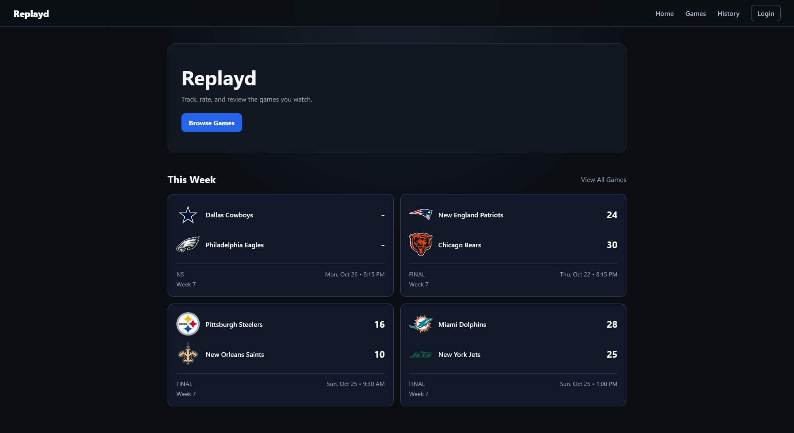
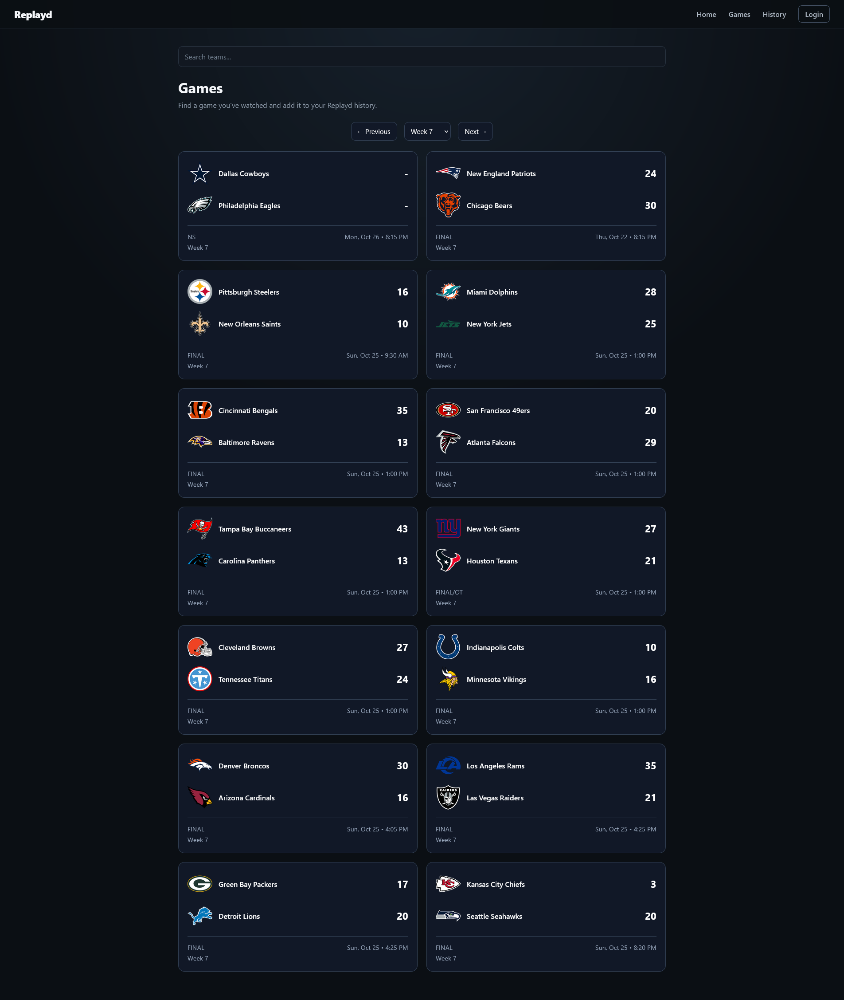
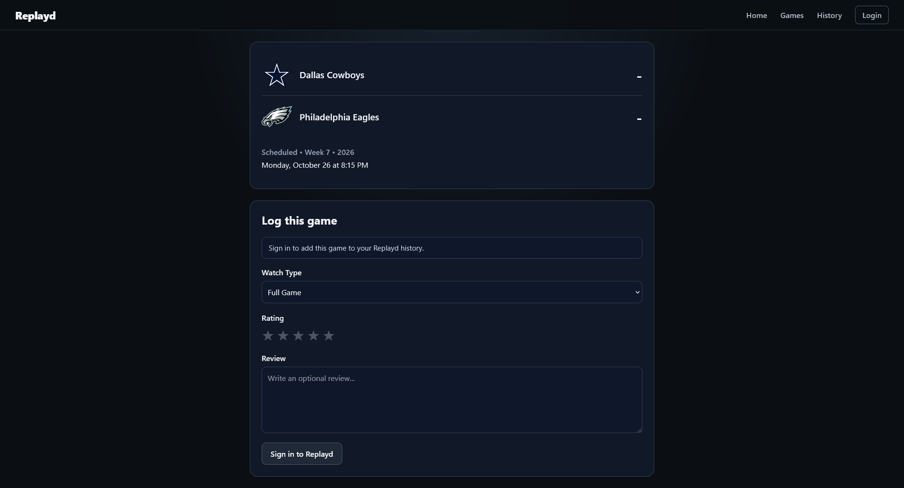
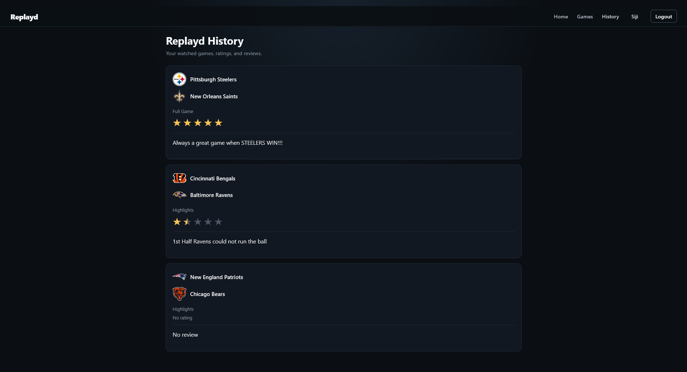
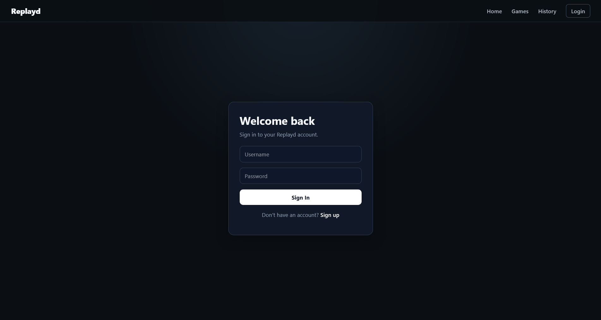
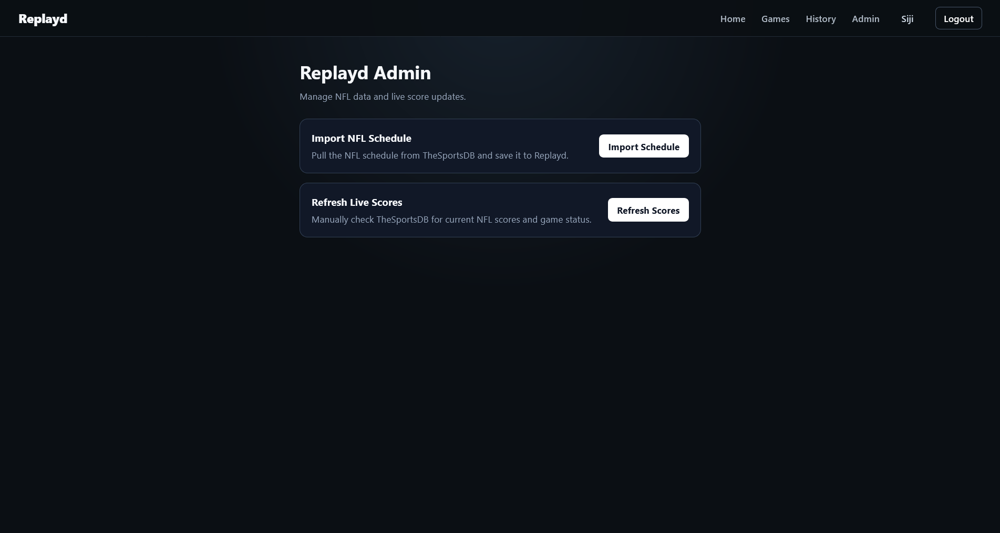
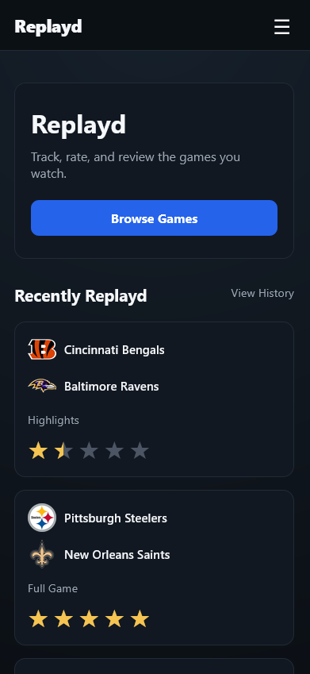

# Replayd

Replayd is a full-stack sports watch log inspired by apps like Letterboxd.

It allows users to browse real NFL games, mark games as watched, rate or review them, and keep a personal history of the games they have Replayd.

The project was built as a full-stack software engineering project with a focus on backend development, REST APIs, authentication, relational databases, real sports data, responsive design, testing, and production deployment.

---

## Live Demo

Replayd is deployed using Render.

- Frontend: https://replayd.onrender.com
- Backend API: https://replayd-backend.onrender.com

---

## What Replayd Does

Replayd gives sports fans a simple way to keep track of the games they watch.

Users can:

- Browse real NFL games
- View game details
- See live and final scores
- Mark games as Replayd
- Choose between Full Game and Highlights
- Add an optional rating
- Write an optional review
- View their personal Replayd history
- Reopen and update existing logs
- Create an account
- Log in securely
- Use Replayd on desktop or mobile

Replayd also includes administrator tools for managing sports data.

---

## Screenshots

### Home



### Games



### Game Detail



### History



### Sign In



### Admin



### Mobile



---

## Features

### Real NFL Games

Replayd imports real NFL schedule data from TheSportsDB.

Each game can include:

- Home team
- Away team
- Team logos
- Game date
- Kickoff time
- Week number
- Score
- Game status

Games are organized so that:

1. Live games appear first
2. Upcoming games appear next
3. Finished games appear last

---

### Live Scores

Replayd automatically refreshes NFL game data.

The backend uses scheduled jobs to:

- Refresh live scores
- Update in-progress games
- Refresh the full NFL schedule
- Catch games that have transitioned from live to final

Replayd recognizes statuses such as:

- Scheduled
- Live
- Halftime
- Final
- Final/OT

---

### Game Logging

Users can mark a game as Replayd.

Each log can contain:

- Watch Type
    - Full Game
    - Highlights
- Rating
- Review
- Logged date

Ratings and reviews are optional.

A user can simply mark a game as watched without leaving an opinion.

If the same user logs the same game again, Replayd updates the existing log instead of creating a duplicate.

---

### Personal History

Each authenticated user has their own Replayd history.

Game logs are associated with the account that created them.

This means:

```text
User A
→ only sees User A's logs

User B
→ only sees User B's logs
```

Users can also reopen previously Replayd games and view their ratings and reviews.

---

## Authentication

Replayd includes custom authentication built with Spring Security and JWTs.

Users can:

- Sign up
- Log in
- Log out
- Access protected routes
- Maintain a private Replayd history

Passwords are never stored directly.

Replayd uses BCrypt to hash passwords before storing them in PostgreSQL.

After successful login, the backend generates a JWT that the frontend sends with authenticated API requests.

---

## Authorization

Replayd currently supports two roles:

```text
USER
ADMIN
```

### USER

Users can:

- Browse games
- Log games
- Rate games
- Review games
- Access personal history

### ADMIN

Admins can also access protected sports-data management tools.

Backend authorization protects admin endpoints even if someone attempts to manually access them.

---

## Admin Tools

Replayd includes an admin dashboard.

Current admin actions include:

- Import NFL schedule
- Refresh live NFL scores

Admin endpoints require the `ADMIN` role.

---

## Tech Stack

### Backend

- Java 21
- Spring Boot
- Spring Security
- Spring Data JPA
- Hibernate
- REST APIs
- JWT
- BCrypt
- Maven
- JUnit
- Mockito

### Frontend

- React
- TypeScript
- Vite
- React Router
- CSS

### Database

- PostgreSQL

### External Data

- TheSportsDB API

### Deployment

- Render Static Site
- Render Web Service
- Render PostgreSQL
- Docker

---

## Architecture

Replayd uses a full-stack client/server architecture.

```text
React + TypeScript
        |
        | REST API
        v
Spring Boot
        |
        | JPA / Hibernate
        v
PostgreSQL
```

The backend also communicates with TheSportsDB:

```text
TheSportsDB
     |
     v
SportsDataService
     |
     v
PostgreSQL
     |
     v
Replayd REST API
     |
     v
React Frontend
```

The frontend does not communicate directly with TheSportsDB.

This keeps the external API key on the backend instead of exposing it in the browser.

---

## Backend Structure

Replayd follows a layered backend structure.

### Controllers

Controllers receive HTTP requests and return API responses.

Examples:

- `GameController`
- `GameLogController`
- `AuthController`
- `SportsDataController`

### Services

Services contain application logic.

Examples:

- `GameService`
- `GameLogService`
- `AuthService`
- `SportsDataService`
- `JwtService`

### Repositories

Repositories communicate with PostgreSQL through Spring Data JPA.

Examples:

- `GameRepository`
- `GameLogRepository`
- `UserRepository`

### Models

Main entities include:

- `Game`
- `GameLog`
- `User`

---

## Data Relationships

A simplified Replayd relationship looks like:

```text
User
 |
 | has many
 v
GameLog
 |
 | belongs to
 v
Game
```

Multiple users can log the same NFL game while still maintaining separate histories.

---

## API Examples

### Games

```http
GET /games
GET /games/{id}
```

### Game Logs

Authenticated routes include:

```http
POST /game-logs
GET /game-logs
GET /game-logs/{id}
GET /game-logs/game/{gameId}
```

### Authentication

```http
POST /auth/signup
POST /auth/login
```

### Sports Data

Admin-only routes include:

```http
POST /sports-data/nfl/import
POST /sports-data/nfl/live/refresh
```

---

## Running Replayd Locally

### Requirements

Install:

- Java 21
- Maven
- PostgreSQL
- Node.js
- npm

---

### 1. Clone the Repository

```bash
git clone https://github.com/SijiLay/Replayd.git
cd Replayd
```

---

### 2. Create the Database

Create a PostgreSQL database named:

```text
replayd
```

---

### 3. Configure Environment Variables

Replayd uses environment variables for sensitive configuration.

Example:

```text
DATABASE_URL=jdbc:postgresql://localhost:5432/replayd
DATABASE_USERNAME=postgres
DB_PASSWORD=your_database_password

JWT_SECRET=your_jwt_secret

THESPORTSDB_API_KEY=your_api_key

FRONTEND_URL=http://localhost:5173
```

Do not commit real passwords, API keys, or JWT secrets to GitHub.

---

### 4. Run the Backend

From the root project directory:

```bash
mvn spring-boot:run
```

The backend runs locally on:

```text
http://localhost:8080
```

---

### 5. Run the Frontend

Open the frontend directory:

```bash
cd frontend
```

Install dependencies:

```bash
npm install
```

Run the Vite development server:

```bash
npm run dev
```

The frontend normally runs on:

```text
http://localhost:5173
```

---

## Testing

### Backend

Run backend tests from the root directory:

```bash
mvn test
```

Replayd currently tests areas including:

- Game service behavior
- Game log behavior
- Sports data logic
- Controllers
- Application context startup
- User-specific game log behavior

Game log tests simulate an authenticated user so Replayd can verify that logs belong to the correct account.

### Frontend

Run the production build:

```bash
cd frontend
npm run build
```

This runs the TypeScript build and helps catch production errors before deployment.

---

## Responsive Design

Replayd is designed for both desktop and mobile devices.

Responsive features include:

- Mobile hamburger navigation
- Automatic menu closing after navigation
- Single-column game layouts
- Responsive Home page
- Responsive game detail form
- Mobile-friendly History cards
- Responsive Login and Signup pages
- Full-width mobile buttons
- Responsive Admin tools

---

## Security

Current security features include:

- BCrypt password hashing
- JWT authentication
- Protected API routes
- User-specific game histories
- Role-based admin authorization
- Environment variables for secrets
- CORS configuration
- Protected frontend routes
- Protected backend admin endpoints

Potential future improvements include:

- HttpOnly cookie-based authentication
- Refresh tokens
- Email verification
- Password reset
- More extensive authentication and security testing

---

## Deployment

Replayd is deployed using Render.

### Frontend

React is deployed as a Render Static Site.

### Backend

Spring Boot is deployed as a Render Web Service using Docker.

### Database

Production data is stored in Render PostgreSQL.

The production architecture looks like:

```text
Browser
   |
   v
React Frontend
   |
   v
Spring Boot Backend
   |
   v
PostgreSQL
```

The Spring Boot backend also communicates with TheSportsDB for NFL data.

---

## Project Roadmap

### V1 — Core MVP

- [x] Real NFL games
- [x] Browse games
- [x] Search games
- [x] Week navigation
- [x] Game detail page
- [x] Mark game as Replayd
- [x] Full Game / Highlights
- [x] Ratings
- [x] Reviews
- [x] History
- [x] Live scores
- [x] Scheduled sports-data refresh
- [x] User accounts
- [x] JWT authentication
- [x] Password hashing
- [x] Per-user history
- [x] Admin roles
- [x] Admin dashboard
- [x] Production deployment
- [x] Responsive mobile design
- [x] Automated backend testing

---

### V2 — Social

Planned features include:

- User profiles
- Follow users
- Activity feed
- View friends' ratings and reviews
- Likes
- Comments
- Public profiles
- Spoiler controls

---

### V3 — Game Excitement

Planned sports analytics features include:

- Game excitement score
- Comeback detection
- Close-game detection
- Lead-change analysis
- Overtime weighting
- Play-by-play analysis
- Spoiler-free excitement indicators

---

### V4 — Recommendations

Potential future features include:

- Personalized game recommendations
- Favorite teams
- Similar games
- Recommendations based on ratings
- Sports analytics
- Machine learning

---

## What I Learned

Replayd gave me experience building and deploying a complete application instead of only working on isolated programming exercises.

Major concepts I practiced include:

- REST API design
- Spring Boot architecture
- Service and repository layers
- Relational database design
- JPA relationships
- PostgreSQL
- Authentication
- Authorization
- JWTs
- Password hashing
- React
- TypeScript
- API integration
- Scheduled backend jobs
- CORS
- Error handling
- Responsive design
- Automated testing
- Git feature branches
- Docker
- Production deployment
- Debugging differences between local and production environments

---

## Author

**Olamayowa "Siji" Layeni**

Computer Science student at Virginia Commonwealth University.

GitHub: [SijiLay](https://github.com/SijiLay)